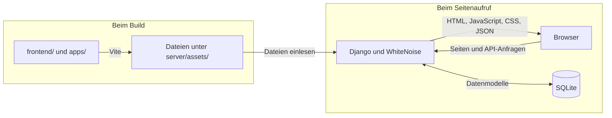

# Portfolio-Architektur

[Dokumentationsübersicht](README.md) · [Prüfungen](checks.md)

Das Portfolio verwendet einen gemeinsamen Django-Server mit Django 5.2.
Er stellt die Portfolio-Seiten, Projektberichte, Demo-Oberflächen und APIs
bereit. Drei Vite-Builds erzeugen die JavaScript- und CSS-Dateien der
Portfolio-Oberfläche, von DeutschLive und der Wohnungssuche.

## Ordner und Zuständigkeiten

| Ordner | Aufgabe |
| --- | --- |
| [frontend/](../frontend/) | Portfolio-Oberfläche, gemeinsame Build-Werkzeuge, Node- und Browsertests |
| [apps/deutsch-live/](../apps/deutsch-live/) | TypeScript-/React-Oberfläche für Sprachlernen, Quiz, Notenrechner und Audioplayer |
| [apps/wohnungssuche/](../apps/wohnungssuche/) | React/Preact-Oberfläche für Angebote, Suchprofile und Suchorte |
| [server/](../server/) | Django-Konfiguration, Datenmodelle, APIs, Templates und statische Dateien |
| [scripts/](../scripts/) | Zentraler Prüflauf für lokale Entwicklung und CI sowie Daten- und Browserhelfer |
| [frontend/scripts/](../frontend/scripts/) | Frontend-Prüfungen, Übersetzungskontrolle und Performance-Werkzeuge |
| [tools/performance/](../tools/performance/) | Separat installierbare Lighthouse-Abhängigkeiten für optionale Messungen |
| [.github/workflows/](../.github/workflows/) | Automatische Builds und Prüfungen auf GitHub |
| `runtime/` | Ignorierte lokale Prüfergebnisse und Arbeitsdateien |

`apps/` ist der gemeinsame Oberordner der beiden App-Oberflächen. Die
Wohnungssuche verwendet Vite, Preact und die Icons aus `frontend/node_modules/`.
DeutschLive besitzt wegen seiner TypeScript-/React-Konfiguration eigene
Node-Abhängigkeiten. Deshalb werden die Pakete in `frontend/` und
`apps/deutsch-live/` installiert.

## Vom Quellcode zur ausgelieferten Seite

| Oberfläche | Build-Ausgabe |
| --- | --- |
| Portfolio | `server/assets/portfolio-dist/` |
| Wohnungssuche | `server/assets/portfolio/wohnungssuche/` |
| DeutschLive | `server/assets/deutschlive-dist/` |

Das Portfolio nutzt die React-API mit `preact/compat`. Django liest das
Vite-Manifest unter `server/assets/portfolio-dist/.vite/manifest.json` und bindet
die passenden Dateien ein. Projektübersicht und Projektberichte erhalten
zusätzlich auf dem Server gerendertes HTML. Der Portfolio-Build exportiert dafür
den Präsentationskatalog `.vite/projects-presentation.json`, den
[Django einliest](../server/pages/projects_overview.py).

Die Startseite lädt die Komponenten für separate Projekt- und Über-mich-Seiten
erst, wenn diese benötigt werden. Für direkte Aufrufe besitzen diese Seiten
eigene Vite-Einstiege. Gemeinsame Komponenten bleiben in geteilten Modulen.

Änderungen an diesen Oberflächen erfolgen in den Quellordnern. Die drei
Ausgabeordner werden beim jeweiligen Build neu erzeugt. Maßgeblich sind die
Vite-Konfigurationen für [Portfolio](../frontend/vite.config.mjs),
[Wohnungssuche](../apps/wohnungssuche/vite.config.mjs) und
[DeutschLive](../apps/deutsch-live/vite.config.ts).

Die Build- und Startbefehle stehen in der
[Hauptanleitung](../README.md#lokal-starten). Der Portfolio-Entwicklungsserver
unter Port 5173 bietet zusätzlich Vite mit automatischem Neuladen und leitet
API-Anfragen an Django weiter.

Der [gemeinsame Prüflauf](../scripts/check_beirit.py) definiert Builds und Tests
für lokale Entwicklung und GitHub CI. Die Aufteilung in Prüfgruppen und die
Berichtspfade stehen in der [Prüfanleitung](checks.md).

## Projekte und Routen

| Projekt | Aktive Quellen | Einstieg im gemeinsamen Server |
| --- | --- | --- |
| Sprachlernplattform | [DeutschLive](../apps/deutsch-live/), [lessons](../server/lessons/), [Vokabelbox](../server/assets/vokabelbox/) | `/deutschlive/`, `/vokabelbox/` |
| Wohnungssuche | [App-Oberfläche](../apps/wohnungssuche/), [Housing-API](../server/pages/housing_api.py) | `/wohnungssuche/` |
| Botanic mit Wetter | [botanic](../server/botanic/) | `/botanic/`, `/botanic/wetter/` |
| Shop | [shop](../server/shop/) | `/shop/` |
| Vertragsgenerator | [contracts](../server/contracts/) | `/vertragsgenerator/` |
| Notenrechner | [Statische Rechner-Demo](../server/assets/portfolio/notenrechner/) | `/static/portfolio/notenrechner/index.html` |

Der statische Notenrechner wird direkt aus seinen gepflegten Dateien
ausgeliefert. Die Vokabelbox ist ein Modul der Sprachlernplattform; sie verwendet
ein [gemeinsames Template](../server/templates/modules/vokabelbox_content.html)
und die Dateien unter `server/assets/vokabelbox/`.

Die wichtigsten API-Einstiege sind `/api/projects/` für Projektdaten,
`/api/contact/` für Kontaktanfragen, `/deutschlive/api/` für die Lernplattform,
`/wohnungssuche-api/` für Suchprofile und Konten sowie `/api/shop/` für die
Shop-Demo. Die Routen sind in [server/config/urls.py](../server/config/urls.py)
und [server/pages/urls.py](../server/pages/urls.py) eingebunden.

## Daten und Demo-Betrieb

Django verwaltet die Konten, Datenmodelle und Migrationen. Die lokale
Python-Umgebung liegt unter `server/.venv/`; die SQLite-Datenbank standardmäßig
unter `server/data/db.sqlite3`. Lokale Datenbanken und Medien bleiben ignoriert,
ebenso Konfigurationsdateien wie `.env.local` und `.env.production`. Gemeinsame
Prüfungen verwenden separate temporäre Datenbanken und Verzeichnisse; Details
stehen in der [Prüfanleitung](checks.md).

Die [Portfolio-Grenzen](../README.md#musterdaten-und-grenzen) beschreiben den
Umgang mit Beispieldaten, Zahlungen und lokalen E-Mails. Separate Backends und
ältere Referenzprojekte wurden außerhalb des Repositorys archiviert.

Historische Datenmodelle und Migrationen sichern die Kompatibilität vorhandener
lokaler Datenbanken. Frühere Dienstleistungsfunktionen wie Terminkalender,
Kundenpostfach und Datenbankexport besitzen keine aktiven Routen oder
Admin-Oberflächen mehr. Vorhandene Weiterleitungen und referenzierte
Produktbilder bleiben Teil der Anwendung.
